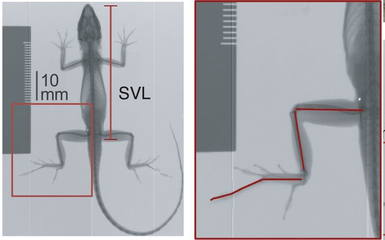
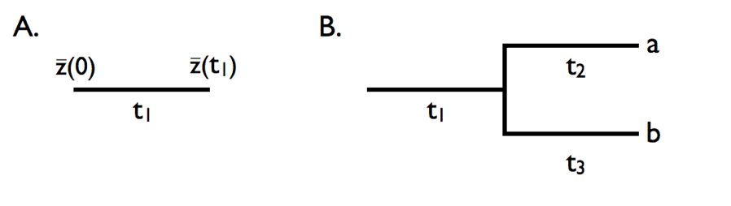

<style>
div.green { background-color:#c7d1c0; border-radius: 5px; padding: 20px;}
</style>

<!-- Add icon library -->
<link rel="stylesheet" href="https://cdnjs.cloudflare.com/ajax/libs/font-awesome/5.14.0/css/all.min.css">

# Introduction

After having learned the basics of working in R and using the `tidyverse` to perform operations on data, we'll now move on to visualizing data and assessing assumptions (i.e., models) and hypotheses (based on models) concerning our data. We'll do so in the context of the ecomorphology of [anoles](https://en.wikipedia.org/wiki/Anolis), an exceptionally diverse genus of iguanian squamates that comprises well over 400 species.

The central theme of this project will be to assess the morphological and allometric differences between ecomorphs within the genus *Anolis*. First coined by the famous evolutionary biologist and herpetologist Ernest Williams, the term ecomorph describes a group of species, perhaps not sharing a most recent common  ancestor, with a similar ecological niche and behavior within the context of this niche. His model for this concept was the genus *Anolis*, although the ecomorph construct has been widely applied to many other species (think reef fish and Darwin's Finches). 

<center>


</center>

Our tasks will be to:

  1. Visualize how hind limb length varies with size (i.e., allometry!).
  2. Visualize and asses how hind limb length vs. size relationship covary with ecological niche.
  3. Learn more complex operations in `ggplot` than we've undertaken so far. 
  4. Evaluate this hindlimb-size relationship using standard frequentist models with and without a phylogenetic context.
  5. Using an information theory approach, assess the fit of phylogenetically corrected models of hind-limb variation under different modes of character evolution.

# Set up

We have a few data sets that need to be downloaded:

  + A file of [morphological data from 46 species of anole](anole.dat.csv).
  + A file of [ecomorphological data from the same 46 species](anole.eco.csv).
  + A tree file containing the [phylogenetic relationships of these species](anole.tre).

The morphological and ecological data were retrieved from a recent study of allometry and ecomorphology of anoles (geckos, too) by @hagey2017there. The tree data come from a study of the phylogenetic relationships of anoles by @poe2017phylogenetic.

As we have in the previous projects, let's load the packages we need (make sure they're downloaded!), then load these data and comment on the importance of it. 
  
```{r,results='hide',warning=F,message=F}
library(tidyverse) # Rember to load your libraries!
library(ape)
library(nlme)
library(geiger)
library(caper)
library(phytools)
library(viridis)
library(MuMIn)

#load data
anole <- read_csv("anole.dat.csv")
anole.eco <- read_csv("anole.eco.csv")

```

The data loaded to `anole` are species (`Species`), mean snout-vent length (`SVL`, length between the snout and the vent, i.e., anus, a standard for reptiles), and the mean total hind-limb length (`HTotal`). The figure below from @lapiedra2018predator indicates how these measurements are taken on specimens of anoles.


<center>

[]

</center>

As with the main data set from the last project, this `anole` data set doesn't include important information about the data, specifically from which ecomorph the data were taken. Thus, we must merge the `anole` data tibble with the `anole.eco` tibble and, simultaneously, do a few things required for working with data in this context:

```{r}

anole2 <- anole%>%
left_join(anole.eco)%>%
  filter(!Ecomorph%in%c("U","CH"))%>%
  na.omit()%>%
  mutate_at(c("SVL", "HTotal","PH","ArbPD"),log)
  
```

Notice that, before the mutate operation, we filtered the data, removing any rows is the tibble for which the `Ecomoroph` value was "U" or "CH". These are species for which the ecomorphological designation was unique ("U", i.e., unique to that species) or *Chamaeleolis*, a subgenus of the genus *Anolis* that had very few observations in the study. We use the `filter()` function, asking it to keep any values in the `Ecomorph` column that **are not in** `c("U","CH")` using `!`. 

Notice that we also omitted any rows of the tibble that had missing values (i.e., `NA`) in any of the columns with `na.omit`. That is, we only want to work with a complete data set. We've saved this filtered tibble to a new name, `anole2`

In the last operation, we have mutated our collective tibble containing morphological and ecological data so that we changed our columns containing size and ecological data to natural log transformations of their values, each for `SVL`, `HTotal`, `PH` and `ArbPD`. These are continuous data, i.e., they are not discrete and log transformation converts these data to proportional representations. This will be important for both our analysis of allometry and use in a phylogenetic comparative framework. We did this with `mutate_at`, a function that allows us to mutate columns in place, replacing each that we identify with the names wrapped in `c()`. The second argument in `mutate_at` specifies what we'll do to the columns, in this case `log`, the natural log (*ln*). 


<div class = "green">
<div class="row">
  <div class="col-sm-2"><a class="far fa-sticky-note fa-5x" style="color:#939681"></a> <!-- regular style --></div>
  <div class="col-sm-9">

Why have we log-transformed our size and ecological data? This, from Luke Harmon's -@harmon2018phylogenetic excellent book on phylogenetic comparative methods, explains why.

>One general rule for continuous traits in biology is to carry out a log-transformation (usually natural log, base e, denoted ln) of your data before undertaking any analysis. This also applies to comparative data. There are two main reasons for this, one statistical and the other biological. The statistical reason is that many methods assume that variables follow normal distributions. One can observe that, in general, measurements of species' traits have a distribution that is skewed to the right. A log-transformation will often result in trait distributions that are closer to normal. But why is this the case? The answer is related to the biological reason for log-transformation. When you log transform a variable, the new scale for that variable is a ratio scale, so that a certain differences between points reflects a constant ratio of the two numbers represented by the points. So, for example, if any two numbers are separated by 0.693 units on a natural log scale, one will be exactly two times the other. Ratio scales make sense for living things because it is usually percentage changes rather than absolute changes that matter. For example, a change in body size of 1 mm might matter a lot for a termite, but be irrelevant for an elephant; whereas a change in body size of 50% might be expected to matter for them both.

</div>
</div>
</div>
<br>

# Visualizing Data, Forming and Refining Hypotheses

## Visuallization as a First Stab

Before we undertake any analysis of data, we should first visualize it so that we can begin to evaluate what reasonable questions about the data set can be asked. After that, we apply a model to see how best to describe the relationships we care about. 

In the context of this project, we have before us an important initial question: does hind limb length vary with size? This may seem like a no-brainer. A larger animal almost always has larger legs, longer toes, and bigger muscles simply because it is larger. Thus, we must account for body size (i.e., SVL) if we're to explore whether  groups of species evolved any specific adaptation for living in different niches. That is, controlling for **allometry** isolates the important stuff, perhaps specialization in form that differ from baseline differences in growth. So, let's assess this initially by plotting hind limb length vs size in anoles with `ggplot`. We'll start with the log-transformed data set.

```{r}
anole2%>%
  ggplot(aes(SVL,HTotal))+
  geom_point()+
  geom_smooth(method="lm")
```


Remember that we have to establish the aesthetic of the plot and then add geometries with `+` to plot. Here we established the aesthetic in `aes()` for our `ggplot` as `SVL` for the x values and `HTotal` for the y (remeber that these are log-transformed valued), then added two geometries, points and a smooth line built on a linear model using `method="lm"`. 


Based on this simple plot, it appears size does predict HTotal. 

## Modeling: Formulations of Questions and Hypothesis

Now that we've spotted a conspicuous pattern, it's time to test the empirical robustness with our first model. To reframe where we stand, we may perhaps put it this way: HTotal varies with SVL. That is, we have one continuous variable, a covariate, influencing another. For this sort of question, a linear model is a good place to start. 


Specifically, as you see from the plot, the data look to have a linear relationship, that is `HTotal` can be modeled as a linear response to `SVL` or 

$$log(Htotal)=log(\beta_0)+\beta_1{\cdot}log(SVL)+\epsilon$$,

where, $\beta_1$ is the slope and $\beta_0$ the intercept.

Although the `geom_smooth` geometry adds predictions based on this simple linear model and it looks to be a good fit, lets evaluate the robustness of this fit by establishing a simple linear model using the `lm()` function from the `stats` package which loads automatically with R. 

```{r fit1}

fit1 <- lm(HTotal~SVL,anole2)

```

Notice how the model is represented by the relationship `HTotal~SVL`. Using `~` is a standard convention in R for model formulae where a variable to the left of `~` is predicted by one or more variables to the right. So here where asking R to build a linear model with `HTotal` predicted by `SVL`. The second argument specifies what data the variables are coming from, in this case, `anole2`.

Now that we have our linear model, we can use this to predict `HTotal` for a range of snout vent lengths rather than have `geom_smooth` do it for us. Let's do this by creating a tibble with predictions:

```{r}
SVL2 <- seq(min(anole2$SVL),max(anole2$SVL),0.1)

pred.lm <-tibble(
  SVL=SVL2,
  H.pred=predict(fit1,newdata = data.frame(SVL=SVL2))
)

anole2%>%
ggplot(aes(SVL,HTotal))+
  geom_point()+
  geom_line(
    data=pred.lm,
    aes(SVL,H.pred),
    col="blue"
    )
```

Our predictions match those made by `geom_smooth()`. But, how good are these predictions. For this, let's turn to `summarize()`

```{r summ}
summary(fit1)
```

From calling `summary(fit1)` we retrieved important information about the model. Let
s briefly discuss what's in each section. 

  + The `Residuals`. This section summarizes the distribution of prediction errors, that is, how far the real HTotal data are from the prediction based on SVL. The median, at close to 0, indicates a relatively balanced spread of residuals around the regression line.

  + The `Coefficients`. This table includes information about the coefficients (i.e., slope and intercept). For `Intercept`, `Estimate` gives the estimated value of Htotal when SVL=0 ($\beta_0$). The standard error (`Std. Error`) indicates how much uncertainly there is to this estimated value. The test statistic (`t value`), calculated as $\text{Estimate} / \text{Std. Error}$, is a signal to noise ratio. In a way, this also indicates how many noisy "steps" our slope estimate is from the baseline of 0. Lastly, the p value (`Pr(>|t|)`) reports the probability of getting a `t value` this large under the assumption that the true slope is actually 0.
  
For `SVL`, we have the same columns, including the estimate, standard error, its t value, and p-value. They more or less give us the same thing, but these value's concern the effect of log SVL on log HTotal, that is, the slope of the allometric relationship ($\beta_1$). `Estimate` reports the slope value, `Std. Error` reports the standard error, an important measure of uncertainty. `t value` again represents the signal-to-noise ratio and `Pr(>|t|)` tells us the probability of observing a slope as steep or steeper than this the true slope were zero ($\beta_1 = 0$).

Lastly, the `summary()` output contains overall model fit statistics.
`Residual standard error` reports distance that observed data points fall from the regression line. That is, on average, how much the actual values of HTotal deviate from the predicted values in original log units of HTotal. You can think of this as the remaining unexplained variation of the model. The degress of freedom represent total sample size minus the number of parameters estimated estimated by the model, that is the intercept ($\beta_0$) and the slope ($\beta_1$), + 1 slope = 2 parameters) `Multiple R-squared` represents the proportion of variance explained by the model while the Adjusted R-squared ($R^2_{\text{adj}} = 0.8776$) is a  $R^2$ value that penalize it for adding unnecessary predictor variables to a model. In simple linear regression (1 predictor), $R^2$ and $R^2_{\text{adj}}$ are always very close 
The `F-statistic` is a test statistic that compares your fitted regression model to a "null" model (a flat horizontal line representing just the mean of log HTotal. It's calculated as $\text{Mean Square Model} / \text{Mean Square Residuals}$. 


From this we can gather there's a very strong relationship between log HTotal and log SVL: the error is low (0.056) and the p value of the slope is well below the magic threshold of 0.05. In addition, we don't find any evidence that the slope isn't 0 (`Pr(>|t|)`=0.097. We should also emphasize that the `F-statistic` value of 323.5 indicates the regression line explains far more variance than background noise and the the proportion of variance explained by the model is high (both $R^2$ values are over 0.8).


Because we're assessing how a variable relates to size, we have, as was mentioned previously, a question of allometry. In allometry, the log-log slope represents the scaling exponent, the value of which tells what sort of allometry we have. Furthermore, allometry is often modeled as a simple power function of the non-log transformed variables, that is:


$$Htotal={\alpha\cdot}SVL^{\beta}$$,

where $\alpha$ is the intercept and $\beta$ is the scaling exponent. 

In any case, whether we use the power function or log-log linear relationship as we did in `fit1`, $\beta$ tells us if we have a scaling relationship or a linear one:  $\beta$<1 represents negative scaling, $\beta$>1 positive scaling, and $\beta$=1 no scaling, or simply a linear relationship.

Looking above, $\beta$=1.00, indicating a distinct linear between Htotal and SVL. No matter, for the reasons explained above, it's best to keep the log transformation and move on with our analysis. 


## Refining Hypotheses With More Complex Visualization and Models

Now that we've modeled this conspicuous pattern and found that it is robust (i.e., high $R^2$ value, low p value), it's time to pivot to more complicated questions that relate to ecomorph. We've established that HTotal varies with SVL, but does ecomorphology influence patterns in this relationship?  Again, let's turn to visualization first and then, depending on what we see, refine out models.

If we're interested in whether ecomorph affects the relationship between Htotal and SVL, a good place to start visually is to color our points in a scatter plot representing the HTotal vs. SVL relationship. This is easily done by adjusting the `aes()` of our `ggplot` operations by adding a color argument, one that tracks with our `Ecomorph2` column in our date. One can  use `color=Ecomorph2`, `col=Ecomorph2`, or, if you're British, `colour=Ecomorph2`. These are synonymous.

```{r coloreco}
anole2%>%
  ggplot(aes(SVL,HTotal,col=Ecomorph2))+
  geom_point()+
  geom_smooth(method="lm")
```


Well, indeed, it appears ecomorph does, at least qualitatively, affect the relationship between HTotal and SVL. For instance, the trunk-ground and grass-bush tend to have higher HTtotal values when considering SVL compared to other ecomorphs (i.e., the intercepts appear different). The response (i.e., the slope) of HTotal vs SVL may indeed be different between some of the ecomorphs as well (e.g., the twig and the trunk-crown ecomorphs versus the others).

As another iteration in our visual-then-model framework, we can turn to linear models to assess how robust this visual pattern is. Reframing where we stand once more, we may perhaps state the following as a way to implement a new, more explicit model: HTotal varies with SVL, and ecomorphology likely influences not only the overall magnitude of HTotal relative to body size, but also the slope of that scaling relationship.

Given this potentially new understanding of the HTotal-SVL relationship, how do we construct models that reflect these patterns, which, by and large, constitute new hypotheses?  The answer is to alter our bare-bones linear model defined by the `HTotal~SVL` in `fit1`. Specifically, we can expand our simple linear model (`HTotal~SVL`) by incorporating ecomorph as a categorical predictor that is:

1. Simply additive, a case in which ecomorph shifts each group's intercept and assumes identical, parallel slopes for each.

Or

2. Interacting, a case in which both the intercepts and slopes of the HTotal-SVL relationship are allowed to vary by ecomorph.

In the parlance of statisticians, we are seeking to fit models without and with interactions, respectively. R has standard syntax for such models. In our first case, without interactions, we can take our `HTotal~SVL` formula and simply add `+Ecomorph2` to arrive at `HTotal~SV+Ecomorph2`. To include interactions, rather than additive effects, we use at `*` rather than `+`, to arrive at `HTotal~SVL*Ecomorph2`.

Let's implement both and then evaluate how well the data fit these alternative models with `anova()`, considering first `anova(fit2)`.

```{r fits}

#without interactions/additive
fit2 <- lm(HTotal~SVL+Ecomorph2,anole2)

#with interactions
fit3 <- lm(HTotal~SVL*Ecomorph2,anole2)

anova(fit2)
```
There's lot's to untangle here. Let's look at what `anova()` is doing column-by-column, when it's run on `fit2`, that is, on a model that includes `HTotal ~ SVL + Ecomorph2`. 

  + `Df` (Degrees of Freedom). `SVL`: This is 1 (because SVL is a continuous numeric covariate). `Ecomorph2`: Equal to $k - 1$, where $k$ is the number of distinct Ecomorph2 levels present in the dataset (trunk-ground, crown-giant, grass-bush, etc.).Residuals: $N - 1 - \text{Df}_{\text{SVL}} - \text{Df}_{\text{Ecomorph2}}$, where $N$ is the total number of anole observations.
  
  + `Sum Sq` (Sum of Squares). `SVL`: the variation in HTotal accounted for by SVL alone. `Ecomorph2`: the additional variation in HTotal explained by Ecomorph2, after controlling for SVL. Residuals: Unexplained variation (i.e., error) remaining in HTotal after accounting for both SVL and Ecomorph2.
  
  + `Mean Sq` (Mean Squares). Calculated as $\text{Mean Sq} = \frac{\text{Sum Sq}}{\text{Df}}$ for each row. `Residual Mean Sq` represents the estimated residual variance of the model.
  
  + `F value` (the $F$-Statistic). Calculated as $F = \frac{\text{Mean Sq}_{\text{Term}}}{\text{Mean Sq}_{\text{Residuals}}}$. This is a measure how much larger the variance explained by a specific predictor (SVL or Ecomorph2) is relative to the unexplained random noise.
  
  + `Pr(>F)` (the $p$-value). The probability of observing an $F$-statistic as extreme as (or more extreme than) the calculated value if the variable had no effect on HTotal. As you may have assumed, $p < 0.05$ generally suggests a statistically significant effect.

  
The sum of squares and F value are pretty high, while the p-values are well below 0.5 for each term (SVL and Ecomorph2) indicating each has a strong effect on Htotal and that these effects are statistically insignificant. 

<div class = "green">
<div class="row">
  <div class="col-sm-2"><a class="far fa-sticky-note fa-5x" style="color:#939681"></a> <!-- regular style --></div>
  <div class="col-sm-9">
What is a residual you ask? A residual is a measure of how well a prediction or line (i.e., a model) fits an individual data point. In the plot above, this is the distance in terms of the y value that any point differs from the model prediction, i.e., the line in the plot.
</div>
</div>
</div>
<br>

Let's now look at the output of `anova(fit3)` to assess the fit of a model with interactions. 

```{r interactions}
anova(fit3)
```

Note that it looks much the same as `anova(fit2)`, but has an additional row for the interactions. When R constructs a model with interactions, it add an interaction term (indicated by `:`) to the a simpler model with an additive term. That is, `HTotal ~ SVL * Ecomorph2` is really `HTotal ~ SVL + Ecomorph2 + SVL:Ecomorph2`. For this new row, we have the same things to consider as before:


  + Degrees of Freedom (`Df`). Calculated as $\text{Df}_{\text{SVL}} \times \text{Df}_{\text{Ecomorph2}} = 1 \times (k - 1) = k - 1$. This represents the number of additional slopes being estimated. Remember, this model allows each Ecomorph2 group to have its own unique slope.
  + Sum of Squares (`Sum Sq`). This is th additional variation in HTotal explained by allowing the slope of HTotal versus SVL to vary across Ecomorph2 categories, after accounting for both main effects (SVL and Ecomorph2).
  + `F value`. This indicates how how much more variance is explained by these interactions (separate slopes) compared to the unexplained random noise.
  + `Pr(>F)`. This indicates the probability of the `F value` if no interactions existed.
  
The sum of squares and F value are pretty low, while the p-value is 0.1, indicating that interactions are weak and statistically insignificant. 

Let's go back to our readings in PCM, specifically, where the author, Luke Harmon, points out that standard frequentist approaches to comparative data are often limiting. The standard approach places a premium on evaluating null hypotheses and finding p values that, if low, reject the null, or if high, don't reject it. In the context of what we've covered so far, we've assessed the null hypothesis that `SVL` has no effect on `HTotal` and rejected it based on two statistical tests under several different models one with and one without interactions. 

To answer this second part of the question, we must switch approaches and ask the question in a different way. Let's first tackle this different way of asking our question. At first, we applied linear and non-linear models to the data and asked: "How well do my data fit the model? That is, specifically in the context of least-squares regression, how much do our points vary from the predictions of our models, i.e, what is the magnitude of the residuals? In both cases, the points in our data fit pretty well. However, this isn't the question we really want to be asking. We're asking *which model fits out data best?* See the difference?

To ask this question, we must take a different approach. As outlined in PCM, we could perform likelihood ratio tests. In this approach, we compare the likelihood of two **nested** models. The statistical property of likelihood is defined as the probability, given a model and a set of parameter values, of obtaining a particular set of data. Or, as Harmon put it,  . . . "given a mathematical description of the world, what is the probability that we would see the actual data that we have collected?" This is the right approach for us---find the model, with or without interaction, with a higher likelihood of describing our morphological data better and therefore is a better mathematical approximation of the hindlimb-size relationship. 

However, as we learned in PCM, likelihood ratio tests can only be used in limited cases, specifically to compare two models, one of which is a special case of the other. In other words, one model is exactly the same as the other, except that it is more complex, adding one or more parameters, which, in most cases means other independent variables. 

To compare models of most any type, nested or not, we have an alternative, the information theory approach. Specifically, we can use the Akaike Information Criterion (AIC). This description of the model fit compares the likelihood of the model against the number of parameters estimated. The AIC can be described as favoring the model that provides the best fit to the data with as few parameters as possible. 

AIC is especially sensitive to sample size. Thus, another version of the AIC, one that penalizes models that have small sample sizes relative to the number of parameters, $AIC_c$, is typically used in comparative biology. 

Fortunately, from a few of our packages loaded above, we can compute the $AIC_c$ of both of our models, then compare their fit. Additionally, we can calculate the relative support of each model using AIC weights ($AIC_w$).


```{r}
library(MuMIn)
library(geiger)
#AICc from the MuMIn package
anole_aic <- AICc(fit1, fit2, fit3)

#aicw from the geiger package
anole_aicw <- aicw(anole_aic$AICc)

print(anole_aicw)

```

From our `anole_aic`, we see that the second model, `fit2`, has the lowest AIC score, and **lower scores indicate a better fit**. Note also that `fit3` is too far off of `fit2` with a difference ($\Delta AIC$) of 5.6. A general rule of thumb is that a $\Delta AIC$ of less the 4 indicates roughly equivalent models, 4--8 little support for a lesser fit, and over 10 a poor fit and the model can be ignored. So, because we have$\Delta AIC$ around 6, there's a marginal difference between the better fitting models. 


```{r}
anole.log.eco.lm <- lm(HTotal~SVL*Ecomorph2,anole.log)
summary(anole.log.eco.lm)
anova(anole.log.eco.lm)
```

Notice that we performed an ANOVA test on our new model with the `anova()` function. This is, more precisely defined, a two-way analysis of covariance. That is, we are assessing the effect of a categorical variable (`Ecomorph2`) in the context of how `HTotal` *covaries* with `SVL`. The results of the ANOVA indicates that we should reject the null hypothesis that ecomorph groups do not have separate hindlimb-SVL relationships. This is indicated by the p=3.761e-09 for the `Ecomorph2` variable 

Great! We now have established that ecomorph has a significant effect on the hindlimb-SVL relationship. But, to come back to our readings in PCM and what we discussed above, although this model may have some significant terms, we really want to know if adding the `Ecomorph2` parameter results in a better fit as compared to a simple model that doesn't include this parameter. Put another way, is a model of hindlimb growth that includes ecomorph describing the system better than one that doesn't? Let's establish this simple model with log-transformed data and compare it with AIC and AICw to this more complicated model.

```{r}
anole.log.lm  <- lm(HTotal~SVL,anole.log)
anova(anole.log.lm)
anole.log.aic <- AICc(anole.log.lm,anole.log.eco.lm)
aicw(anole.log.aic$AICc)
```

<div class = "green">
<div class="row">
  <div class="col-sm-2"><a class="far fa-sticky-note fa-5x" style="color:#939681"></a> <!-- regular style --></div>
  <div class="col-sm-9">

Notice that we added our `Ecomorph2` variable to the model with `*` in our model formula: `HTotal~SVL*Ecomorph2`. This could have been done with `+`, but the difference between `*` and `+` is huge. The symbol `+` adds this variable to model and asks the regression to consider if only the intercepts of the groups within `Ecomorph2` will vary, that is, if the mean response of `HTotal` vs. `SVL` is different according to the groups in `Ecomorph2`. The `*` adds an interaction between terms in the model. This asks the regression to consider if the **slopes** of `HTotal` vs. `SVL` is different according to the groups in `Ecomorph2`. Put another way, `SVL*Ecomorph2` considers if `HTotal` responds differently to `SVL` according to `Ecomorph2` This is a good place to start, assuming that different ecological groups have different relationship between the response and the covariate.

</div>
</div>
</div>
<br>

OK, yes! A model with the added `Ecomorph2` parameter results in a much better fit, both in terms of $\Delta AIC$ and AIC$_w$.

Now that we've found a better fitting model, let's explore just how much each ecomorph varies among anoles in their hindlimb-SVL relationship. Think for a second or two how we might go about this. Our problem is a multivariate one: we have the covariaton of `HTotal` vs. `SVL` to consider in the context of ecomorph. As we've learned, visualization is the most important first step of data analysis. But, how should we represent these data in a plot? 

Let's come back to the residual. The residual represents how much any one data point varies from the prediction. If we have a global model that predicts thehindlimb length  based on SVL for all our anole species, we can determine how much each species deviates from the prediction. We can then take the residuals for each species and look for patterns by plotting the residuals versus ecomorph. That is, we need to go beyond plotting points and regressions and plot data based on a categorical values (in this case, `Ecomorph2`). This is easily implemented in `ggplot`.

First we need to compute the residuals based on our global `anole.log.lm` model:

```{r}
anole.log <- anole.log %>%
  mutate(res=residuals(anole.log.lm))
```
For this, we use the `residuals()` function from the `stats` package, computing residuals for the `anole.log.lm` model. Notice that we used a `mutate()` operation to establish a new `res` column that contains the residuals. Notice that we also redefined `anole.log` as a tibble containing this new column. Now, let's plot the residuals against `Ecomorph2`.

```{r}
anole.log%>%
  ggplot(aes(Ecomorph2,res))+geom_point()
```

In this `ggplot()` operation, we established the x variable as `Ecomorph2` and y as the residual (`res`).

From this we see that model deviations (i.e., residuals) are greatest in the twig and trunk-ground ecomorphs. But, this isn't so pleasing. Perhaps we would like a better summarization of the data, including the median residual for each ecomorph. We could do this with more mutations of the data; however, we can let `ggplot` do this with `geom_boxplot()`. This geometry plots summary statistics including the median, hinges that correspond to the first and third quartiles, and whiskers that correspond to 1.5 times the interquartile range.

```{r}
p.eco <- anole.log%>%
ggplot(aes(x=Ecomorph2,y=res)) +geom_boxplot()
print(p.eco)
```  

This is a great summary of our hindlimb-SVL residual data according to ecomorph. But, often, as biologists, we prefer to visualize the mean of values in our a priori groups rather than median. One asset of `ggplot` is that we can add geometries to existing plot. Because we saved out plot as `p.eco`, we can simply add a geometry that includes a representation of mean residual for each ecomorph.

```{r}
p.eco+ geom_boxplot() +stat_summary(fun=mean, geom="point", size=3)
```

Here we added a point with the `stat_summary()` geometry. This applies a summarizing function to the already established group (established by `x=Ecomorph2`) and plots the value of the summary with a specified geometry. The function we applied to the y data is the mean (`fun=mean`) and we specified a point with size 3 for the geometry to add (`geom=point` and `size=3`, respectively). Lovely.


# Not So Fast: Phylogeny Matters

So far we've concluded that ecomorph is an important explanatory variable when it comes to anole hinglimb-SVL relationships. But (and this is the biggest of buts), we've ignored an important and potentially confounding fact. These lizards, like every group of organisms, have an evolutionary history. Because of this, some species are more closely related than others and thus, they cannot be seen as independent samples in the statistical sense. In other words, any trait we seek to study likely covaries with phylogenetic position. For example, in the context of anole hindlimb-SVL data, it is entirely possible, perhaps probable, that more closely related species share a similar pattern. Thus, it may be that any patterns we've uncovered so far are the result of phylogeny, not merely ecomorph alone.

To account for phylogeny in statistical analysis, we must turn to an important toolbox used by organismal biologists, phylogenetic comparative methods (PCMs). PCMs have a long history and today they are defined as any statistical operations that include the use of phylogenies, that is, information from phylogenetic trees. For regression analysis, the modeling approach we've taken on in this project, there exist several PCM procedures that account for phylogeny. Phylogenetic generalized least squares (PGLS) is perhaps the most flexible and widely used among them. 

In typical least squares regression operations performed already, the residuals of any relationship are assumed to be independent and normally distributed. In PGLS, the variance and covariance of the residuals are structured given a model of trait and the closeness of relationships in a phylogenetic tree. So to perform PGLS, we establish this covriation matrix with a tree and assume that the characters have evolved in this tree under some evolutionary model. 

Let's first have a look at the tree. 

```{r}
anole.tree <- read.tree("anole.tre")
plot(anole.tree,cex=0.4)
```

Here we read in the tree using `read.tree` from the `ape` package. This stores the tree as a `phylo` object, a list of branch order, branch lengths, and tip labels. We'll use the `phylo` object in our analysis. One can plot `phylo` objects with the `plot()` function. We added `cex=0.4`. `cex` stands for the character expansion factor----how the size of the text should be adjusted. In this case, the tip label (i.e., species names) are too cluttered if we don't reduce the character size to 0.4 of the default.

Now that we have a tree that we'll use in our PGLS regression analysis, let's consider what we mean by an evolutionary model. By this we mean under what process or mode does a trait (or several) evolve over a tree, from the root to the tips.  Many PCMs assume a Brownian motion model of character evolution. You can think of this as a "random-walk" process. At each point in time, the value of the character walks higher or lower from the previous value. Over time, the sum of these changes describes the change in the value. How much the value can change over time is described by the rate parameter $\sigma^2$---the higher the value, the greater the changes at each point in time. To illustrate the random-walk nature of this process and the effect of $\sigma^2$ on the magnitude of change over time, consider the following 4 simulations each with a 100 simulations with different value of $\sigma^2$ ranging from 1 to 20:

```{r,echo=F}
sig2 <- 0.1
nsim <- 100
t <- 1:100

sim.l <- list()
for(i in c(1,5,10,20)){
sim.i <- tibble(
  sig2=i,
  x=rnorm(n = nsim * (length(t) - 1), sd = sqrt(i)),
  t=rep(t,nsim-1),
  n.sim=unlist(lapply(1:99,function(x) rep(x,100)))
)%>%
  group_by(n.sim)%>%
  mutate(sim.sum=cumsum(x))
sim.l[[paste0(i)]] <- sim.i
}

sim <- do.call(rbind,sim.l)


sim%>%
  ggplot(aes(t,sim.sum,group=n.sim),alpha=0.01)+geom_line()+facet_wrap(sig2~.,ncol=2)+ylab("trait value")

```


Notice, as Harmon pointed out in hist PCM book, this resembles a genetic drift model and indeed BM can be used to model a process of trait evolution under genetic drift. 

In PGLS, or any number of other comparative methods, we can implement this model of character evolution over the tree where time corresponds to the branch lengths and each node of the tree represents a new random walk away from the previous value at the previous node. This from Harmon's PCM book explains the process:

<center>

</center>
<br>


In A, we see the evolution in a single lineage over time period $t_1$. At the end of time $t_1$, the trait will have evolved value $\bar{z}(t_1)$, a magnitude that is approximated by $\bar{z}(0)$ plus the amount of change along the branch (roughly described by $\sigma^2t_1$, the product of the rate parameter and time). In panel B,the evolutionary change described by Brownian motion occurs over a total time of $t_41$+$t_2$. Thus, the change at this tip ($\bar{x}_a$) would be equal to the starting value, $\bar{z}(0)$ plus $\sigma^2(t_1+t_2)$. Similarly, the change at tip "b" would be equal to $\bar{z}(0)$ + $\sigma^2(t_1+t_3)$. Note that the mean value for tips "a" and "b" ($\bar{x}_a$) and $\bar{x}_b$) are not independent: the two tips share a branch in common and each tip's trait value is the ancestral value plus the sum of two separate evolutionary changes. In a more complex tree with many taxa, this process is modeled from the root (the ancestor or all species) to every tip. 
 
Another way to model character evolution over a tree, an Ornstein-Uhlenbeck (OU) model, is a little more complicated, however, worth mentioning because it remains a popular alternative model to the BM process. We won't go into the same detail  because of its similarity to BM and the mathematics are somewhat involved. In this model, traits evolving over a tree are "pulled" toward an optimum and this is often assumed to model a process of stabilizing selection (although other processes the result in optima can't be ruled out). The process of fitting an OU model is quite similar to BM including a starting value ($\bar{z}(0)$), the evolutionary rate $\sigma^2$, and the additional parameters of the trait optimum ($\theta$) and strength of selection ($\alpha$). The $\alpha$ parameter determines how strongly the trait is pulled back to the optimum and, for this reason, is sometimes referred to as a "rubber band" parameter. It's important to note that when $\alpha$=0, i.e., no selection, the OU is mechanistically identical to the BM process.

Now that we have explained the theory behind a few evolutionary models and we have a tree for our anoles, let's perform some PGLS under these two different models: both with simple regression models that doesn't include ecomorph and then models that do. We'll start with setting up the code using `gls()` from the `nlme` package and then discuss what's in it.

```{r,error=TRUE}


#PGLS under BM, no ecomorph
pgls.BM1 <- gls(HTotal ~SVL, correlation = corBrownian(1,phy = anole.tree,form=~Species),data = anole.log, method = "ML")

#PGLS under BM, w ecomorph
pgls.BM2 <- gls(HTotal ~SVL * Ecomorph2, correlation = corBrownian(1,phy = anole.tree,form=~Species),data = anole.log, method = "ML")


#PGLS under OU, no ecomorph
pgls.OU1 <- gls(HTotal ~SVL, correlation = corMartins(0,phy = anole.tree,form=~Species),data = anole.log, method = "ML")

#PGLS under OU, w, ecomorph
pgls.OU2 <- gls(HTotal ~SVL * Ecomorph2, correlation = corMartins(0,phy = anole.tree,form=~Species),data = anole.log, method = "ML")

```


What we did here is set up generalized least squares models that establish a correlation matrix based on BM and OU models of evolution. We establish this matrix with `corBrownian()` from the `ape` package for the BM models and `corMartins()`, also from `ape`, for the OU models. The `corMartins()` function for establishing the OU covariation matrix is so name by the `ape` authors as an homage to @martins1997phylogenies, the paper that most precisely defined the OU model in comparative analysis [see note below]. Notice that we don't have to specify what any of the parameters are; they are estimated under maximum likelihood when `method=ML`.  For the BM model, we used a stating starting value of 1 for $\sigma^2$ and for the OU model we used a starting value of 0 for $\alpha$. In each correlation function, we have to specify the tree (`anole.tree`) and the column names in data that will form the covariation matrix, that is, species (`~Species`). 

<div class = "green">
<div class="row">
  <div class="col-sm-2"><a class="far fa-sticky-note fa-5x" style="color:#939681"></a> <!-- regular style --></div>
  <div class="col-sm-9">
The field of phylogenetic comparative methods, like the discipline of biology as a whole, is remarkably white and especially male. Yet, several woman have made important contributions to comparative methods. [Emilia Martins](https://sols.asu.edu/emilia-martins), a computational mastermind and lead author in  @martins1997phylogenies, is one of these distinctive female scientist who has contributed so profoundly to the field. 
</div>
</div>
</div>
<br>


Now that we have our models, we can preform our AIC operations to see which models fit that data best:

```{r}

anole.phylo.aic <- AICc(pgls.BM1,pgls.BM2,pgls.OU1,pgls.OU2)
aicw(anole.phylo.aic$AICc)

```

From the AIC results, we con safely say that a phylogenetically corrected regression model that includes `Ecomorph2` with traits evolving under BM is the best fit. The OU models that specify a pull to some global optimum are rejected. We can interpret this to mean that the traits have evolved randomly, *but* randomly within each lineage.

Next, we can now consider whether `Ecomorph` is a significant factor in predicting the hinglimb-SVL relationship in a phylogenetic context by preforming an ANOVA on our best fitting model, `pgsl.BM2`

```{r}
anova(pgls.BM2)
```

Like our simple linear model, this variable remains significant: `Ecomorph2` has a significant effect on this relationship at p<0.0001. However, if we dig deeper with some visualization, we see that ecomorph isn't as strong as a factor when we consider phylogeny. Let's come back to the residuals of our hinglimb-SVL relationship, but now we'll consider BM evolution of this relationship over the tree. We'll first mutate and redefine our `anole.log` data to include a column for *phylogenetically* corrected residuals and then plot them against ecomorph just as we did in the case of our simple `lm()` model that didn't consider phylogeny:


```{r}
anole.log <- anole.log%>%
  mutate(phylo.res=residuals(pgls.BM2))

p.eco.phylo <- anole.log%>%
ggplot(aes(x=Ecomorph2,y=phylo.res)) +geom_boxplot() +stat_summary(fun=mean, geom="point", size=3)

print(p.eco.phylo)

```

# Plotting More with Less

Now that we have phylogentically corrected residuals in addition to the uncorrected residuals, let's now compare them visually. To do this we could use `ggplot()` to plot two separate boxplots of the uncorrected and corrected residuals. But, this wouldn't be very concise. What we'll do instead is make the `anole.log` tibble longer with respect to the two types of residuals. Think back to the [last project where we made a tibble wider](mod2_proj.html#pivoting_to_different_questions). In that case, we had a column of fin amplitudes (both left and right) and another identifying from which fin the amplitude came. With respect to fin amplitude, this is a long table, and we modified it to wide format with separate columns of values, one for each fin amplitude. In our `anole.log` tibble, we now have this wide format, a column for each type of residual. If we can make this tibble longer, with a column of both residual values and another identifying to which type of residual the value belongs, we can you `ggplot()`'s handy faceting tools to include our boxplots of both residual types in one plot. 

In the previous project, we introduced [the concept of facets](mod2_proj.html#using_customized_functions). If you recall, facets are used to break the plot up into a grid according values in the data. Let's massage the data to a longer format and then use a faceting function from `ggplot` to plot the phlyognetically corrected and uncorrected residuals against ecomorph with a boxplot. This is how it can be done:

```{r}

anole.log%>%
  dplyr::select(Ecomorph2,res,phylo.res)%>%
  pivot_longer(cols=c("res","phylo.res"))%>%
  print%>%
  ggplot(aes(x=Ecomorph2,y=value))+
  geom_boxplot()+
  stat_summary(fun=mean, geom="point", size=3)+
  facet_grid(name~.,scales = "free_y")+
  ylab("residual")

```

Here we selected the three columns of interest (`Ecomorph2`, `res` [the uncorrected residual], and `phylo.res` [the phylogenetically corrected residual]) in `anole.log` and passed that to a pivoting function, `pivot_longer()`. We specified the columns that will make the tibble longer with `cols=c("res","phylo.res")`. `pivot_longer()` constructed two new columns: one of both these values and another indicating the names of the column from whence they came. `print` was included so that we can see how this works. Notice the `Ecomorph2` column remains and now, rather than separate columns for the values of the residuals, their in a single column `value` and these values are identified by the `name` column. In other words, for each entry of an individual ecomorph in our tibble, there's now two types of residuals identified by name, along with their values in `value`.    

<div class = "green">
<div class="row">
  <div class="col-sm-2"><a class="far fa-sticky-note fa-5x" style="color:#939681"></a> <!-- regular style --></div>
  <div class="col-sm-9">
Notice that the `select()` function in the code above is prefaced with `dplyr::`. This is R speak for "use the function `select` from the `dplyr` package." We have to do this here because a few of the other packages we loaded also have different functions of the same name. A common lament of folks writing code for other folks to use (i.e., packages) is that the toughest part of the work is naming things. That is, one has to be careful. 
</div>
</div>
</div>
<br>

All we had to do from there to plot a boxplot of both residuals for each ecomorph was borrow our boxplot code from above, modifying it a bit to produce the facets. Now, rather than having the y values equal `res` or `phylo.res`, we have it equal `value` in our tibble, a column that reflects values for both types of residuals in our new tibble. Once we add `facet_grid()` to the plot, with `name~.`, we get each type of residual plotted as a boxplot against ecomorph in a separate row. Recall that function takes a formula as input which corresponds to “row facets ~ column facets”, that is, what should the rows and columns in the grid represent. So, we want each of the different values according to `name` (the type of residual), boxplotted in a different row, thus  `name~.`. The `.` tells the facets not to worry about columns as we don't have any additional patterns to plot in the columns. Notice that the facet rows in the plot are name with the values unique values in the `name` column.

We also added `scales="free_y"` to `facet_grid()`. This allows the scale on the y axis to be different in each row. As you can see, the scales of the residuals is much less expansive for the phylogentically residuals than for the uncorrected residuals. Without this, the boxes (hinges, whiskers, etc.) would be indistinguishable for the phylgentically corrected values. 

Lastly, we added a new label to the y axis with `ylab()` to provide a more appropriate name than "value". 

Let's come back to the comparison of the two types of residuals. With our faceted plot before us, we can see that the residuals condense quite a bit when we consider phylogeny. In other words, there was quite a bit of phylogenetic signal in our hindlimb-SVL data. Notice as well when we consider phylogeny, the patterns of which groups vary substantially changes a lot. Take, for instance, the trunk-ground ecomorph: it no longer has such a high mean residual, but is rather pretty close to the phylogenetically corrected mean for anoles. That is, compared to all the other anoles, it's a rather unremarkable group in terms of relative hindlimb size.

# Project Report

It's likely that your head is spinning: we've covered a ton of topics in the project. What's left to do is merely pick up the high points of what we've explored and apply these in a few relatively straightforward operations. 

Let's have your team explore some ecological data and how it effects hindlimb-SVL patterns. We'll not take the a priori ecomorph designations for granted, but rather assess if important ecological parameters of perch height (how high in the tree the anole resides) and the diameter of the perch predicts discrete patterns in the hindlimb-SVL relationship. We'll use the log-transformed values of these variables that are contained in the `anole.log` tibble.

For this project report, write a script named "groupname_module3.R" and undertake the following operations.
  
  1. Combine the code above so that you can establish the `anole.log` data tibble.
  2. Using the log-transformed data, construct two simple linear models that assess the effect of perch diameter and height by including these as covariates in your models. Be sure to use `+` notation rather than `*`, assuming there is no interaction (there isn't, trust me!).
  3. Explore how both perch diameter and height effect the hindlimb-SVL relationship by plotting the residuals of your simple linear models against the discrete factor of ecomorph with a plot of your choice. This will require mutating a data tibble to include residuals from both models. Please produce two separate plots.
  4. Under a BM model of trait evolution and using the tree provided, construct phylogenetic least squares models of the hindlimb-SVL relationships that include the unique combinations of these two covariates, i.e., PGLS models with the following: 
  
  - hindlimb-SVL relationship + perch height
  - hindlimb-SVL relationship + perch diameter
  - hindlimb-SVL relationship + perch height + perch diameter
    
  5. Assess the fit of each of these three models using AICc and AICw and comment on (with comments in the script) whether one or both of the covariates is a significant predictor of hinglimb length in a phylogenetic context. 
  6. Produce a plot of your own design that concisely visualizes the effect of your covariate(s) and factors (i.e., ecomorph) on the hindlimb residuals of the best fitting PGLS model. 
  7. Commit your script to your group repository.
  
**NB**: Please number your operations with a comment to identify which of these prompts you're addressing, e.g. . . 

```{r,eval=FALSE}
#1 establishing the data tibble

dat <- dat%>%
  left_join(dat2)

#2 the two linear models

lm.PH <- lm(HL~PH,dat)
lm.PD <- lm(HL~PD,dat)

#etc., etc.

```

**Each team should push one report script**  as "Module3_TeamX.R" where "X" is the each number. This means one team member should push the team's submission to their team's github directory, i.e., "Module3_Team1", if in Team 1.  Submissions are due by 11:59 PM on Sunday, September 27th.

# References